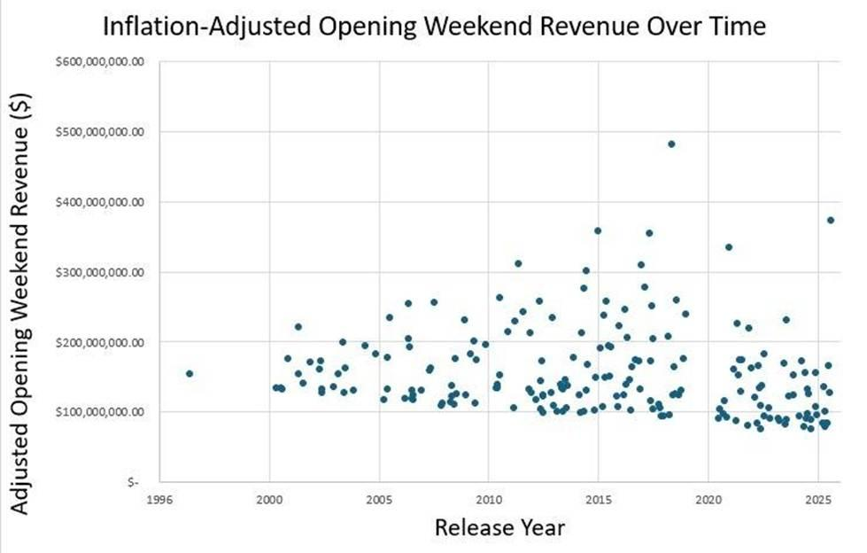
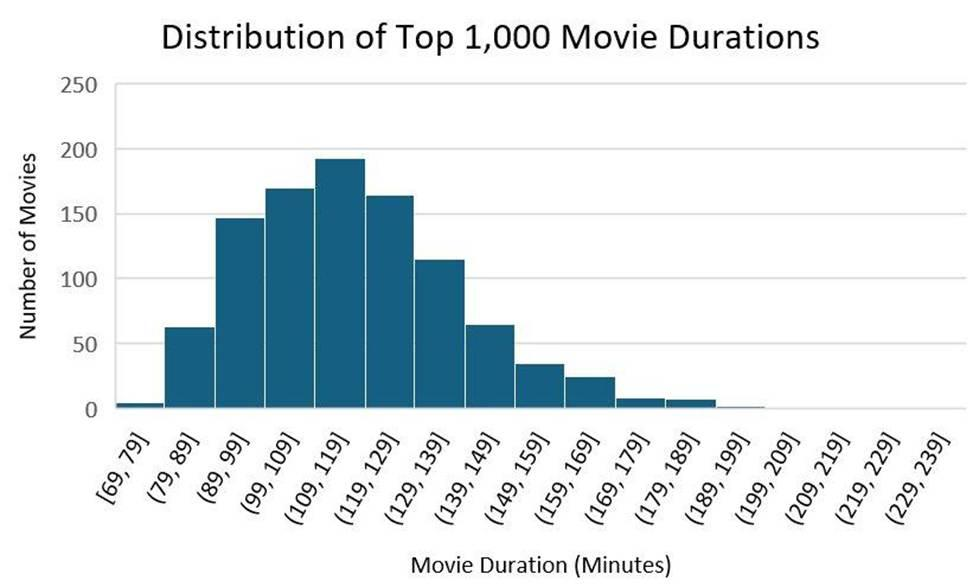
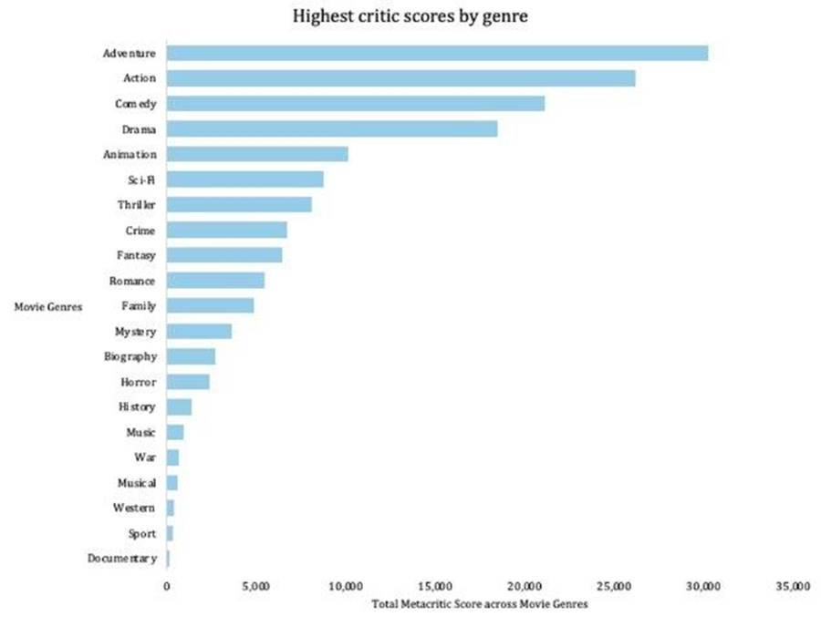
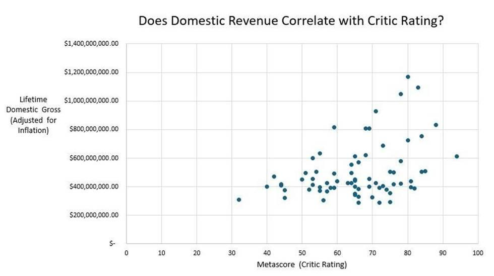

**Team Members:**

- [Henry Oglesby](https://henry-oglesby.github.io/)
- [Holt Zeidler](https://holt-zeidler.github.io/)
- [Ladd Choate](https://laddchoate.github.io/)
- Noah Simson
- Matthew Chafin

## Many movies released after 2020 cluster at lower inflation-adjusted opening weekend revenues, with a few major exceptions.

Over movie history, what has been the trend for opening weekend revenue? Represented in this graph we have taken existing movie data and converted it to modern dollar amount so that the playing field for comparing data is equal across the board. Seen above, it is clearly easy to spot that modern movies since the pandemic have been clustering around a lower dollar amount, showing that factors are pulling the industry average for revenue down. But as in everything, there are always outliers, so there is no one universal truth, just an industry trend.

## Most movies run about 90 to 140 minutes, while fewer long movies create a right-skewed distribution.

What can be seen with the distribution of the top 1000 movies? As seen in the graph above, the distribution of movies centralizes around one hour and 30 minutes, showing an industry average on movie time. The reason for the centralization can be pinpointed to movie budget and existing norms, but some directors like to go a step above and would rather make their movie longer than shorter, as shown with the right skew of this graph. With the longer films, they have more time to show character development and are able to pace scenes without time limitations.

## The total Metacritic score across movie genres appears to be right-skewed, led by Adventure and lowest for Documentary.

What effect does the genre of the film have on its critic rating? Movies that are more tailored for the masses would have to be action, adventure, and comedy, as these are applicable to most people, and as seen with the graph skewed down, some genres do worse than others, as in the case with war, history and sports being a less entertaining topic, which can be related to a smaller interest group for movie watchers. Excel clearly ranks which genres are most preferable in the industry, which can help movie makers decide on what film to make next.

## Higher critic ratings do not consistently relate to higher domestic box office earnings.

Does revenue relate to a movie's critic rating score? As seen in the graph above, there is some correlation to critic rating and revenue, but there are definitely outliers. Just because a movie has a high rating doesn't always mean it will pull in more revenue, as seen in the spread of the data. Excel helps us clearly see that with our x being critic rating and y being domestic gross adjusted: points X 59 and Y 800 million have a sharp contrast with X 82 and Y 380 million.
