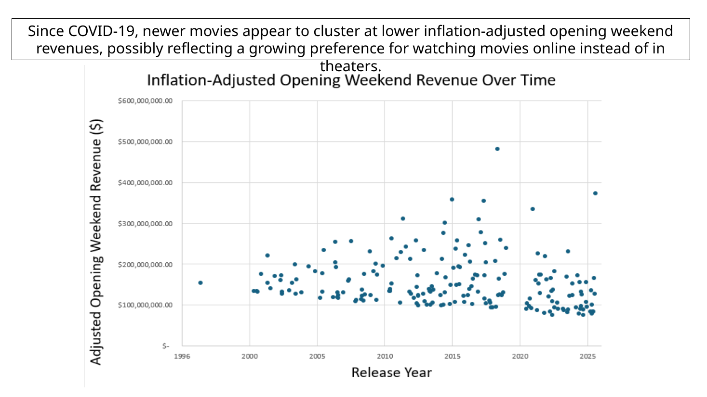
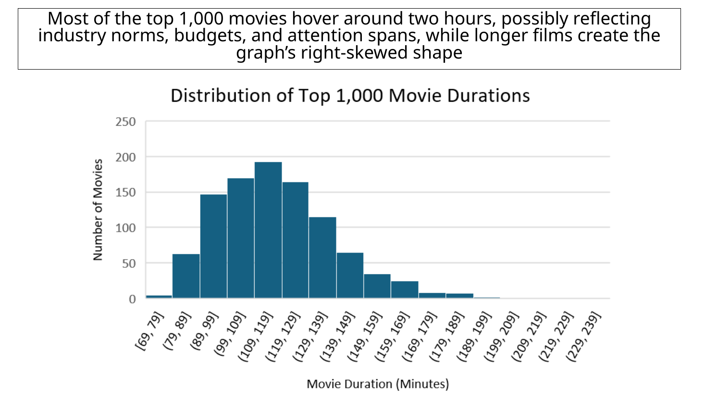
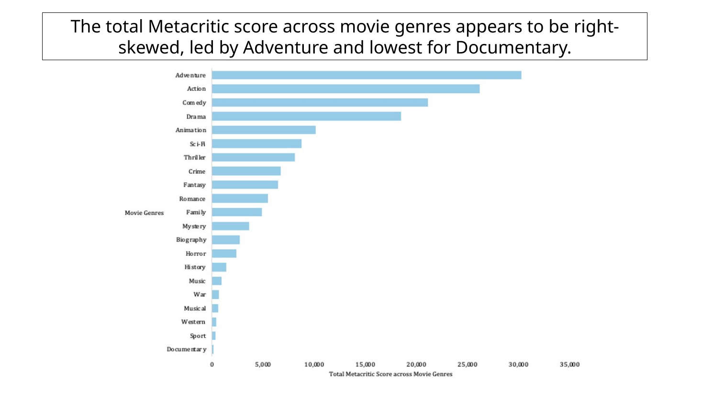
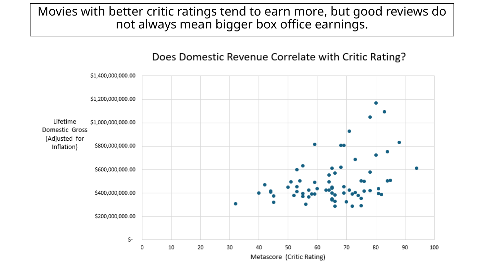

## Team Members

- [Henry Oglesby](https://henry-oglesby.github.io/)
- [Holt Zeidler](https://holt-zeidler.github.io/)
- [Ladd Choate](https://laddchoate.github.io/)
- Noah Simson
- Matthew Chafin

## The Data Set

We used a movie data set with information on popular films released from the late 1990s through 2026. Each row is one movie. The columns include release date, domestic opening weekend revenue, lifetime domestic gross, runtime in minutes, genre, and Metacritic critic score. We adjusted the revenue numbers for inflation so that older and newer movies could be compared in today's dollars. The runtime histogram uses the larger top 1,000 movies list.

## Question 1: How has opening weekend revenue changed over time?

**Why it's interesting:** Movie theaters were shut down during COVID-19, and a lot of people got used to streaming movies at home. We wanted to know if that showed up in how much new movies make on their opening weekend.

**How we used Excel:** We added a column that converts each movie's opening weekend revenue into today's dollars, so every movie is compared on the same scale. Then we sorted the movies by release date.

**How we made the visual:** We made a scatter plot in Excel with release year on the x-axis and inflation-adjusted opening weekend revenue on the y-axis. Then we added a chart title and axis titles. We pasted the chart into PowerPoint and put our main finding in a sentence across the top of the slide.

## Question 2: How long are most of the top 1,000 movies?

**Why it's interesting:** Some movies are under 90 minutes and others run over three hours. We wanted to see if there is a "normal" length that most movies stick to.

**How we used Excel:** We used the runtime column for the top 1,000 movies and grouped the runtimes into 10-minute bins (69–79, 79–89, and so on). Then we counted how many movies fell into each bin.

**How we made the visual:** We made a histogram in Excel from the runtime column. We set the bin width to 10 minutes, then added a title and axis labels for Movie Duration (Minutes) and Number of Movies. After pasting it into PowerPoint, we added a headline saying that most movies run about two hours and that the longer films make the graph right-skewed.

## Question 3: How does genre relate to critic scores?

**Why it's interesting:** Studios have to decide what kinds of movies to make. We wanted to see which genres show up the most among critically reviewed movies, and which ones barely appear.

**How we used Excel:** Many movies are listed under more than one genre, so a movie's Metacritic score counted toward every genre it belongs to. We used SUMIF to add up the Metacritic scores for each of the 21 genres. Then we sorted the totals from highest to lowest.

**How we made the visual:** We made a horizontal bar chart in Excel from the sorted genre totals, so Adventure is at the top and Documentary is at the bottom. We added axis titles and pasted the chart into PowerPoint. Then we added the headline sentence. The bars are total scores, not averages, so genres with a lot of movies, like Adventure and Action, end up with the biggest totals.

## Question 4: Do movies with better critic ratings make more money?

**Why it's interesting:** Good reviews seem like they should bring in more people. But some movies critics don't like still make a huge amount of money. We wanted to see how strong the connection really is.

**How we used Excel:** For each movie, we matched up its Metascore with its lifetime domestic gross adjusted for inflation. That gave us two columns we could plot against each other.

**How we made the visual:** We made a scatter plot in Excel with Metascore on the x-axis and inflation-adjusted domestic gross on the y-axis. We added a chart title and axis titles and pasted the chart into PowerPoint with the headline above it. Two movies show the exceptions well. Star Wars: The Force Awakens had a score of 59 and earned about $815 million. Harry Potter and the Goblet of Fire had a higher score of 82 but earned about $389 million.

## Takeaway

Taken together, the graphs show there is no single formula for a successful movie. Newer movies have tended to open lower since COVID-19. Most movies stay around two hours long. Good reviews help, but advertising, release timing, and loyal fans can matter just as much.
